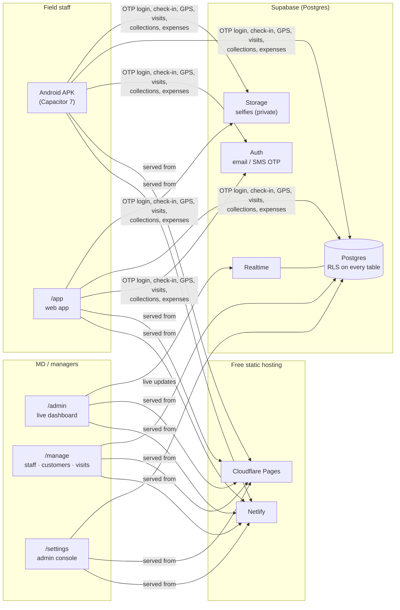
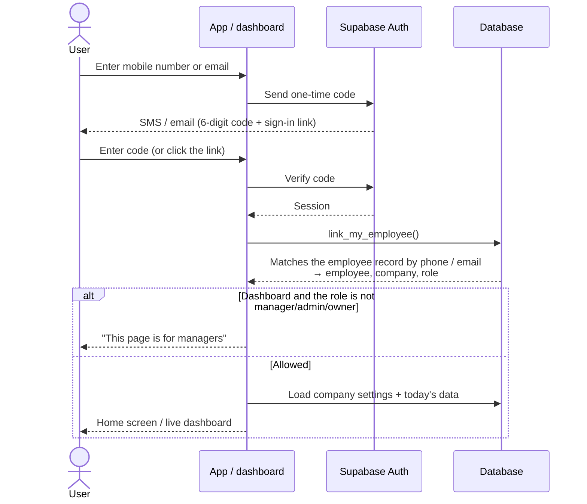
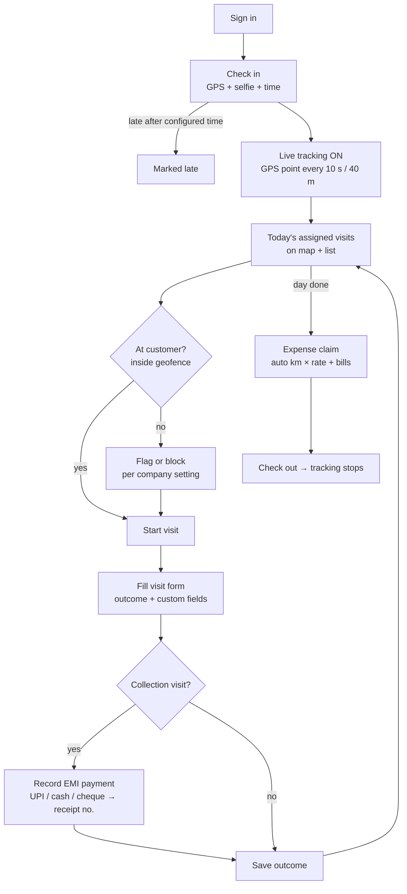
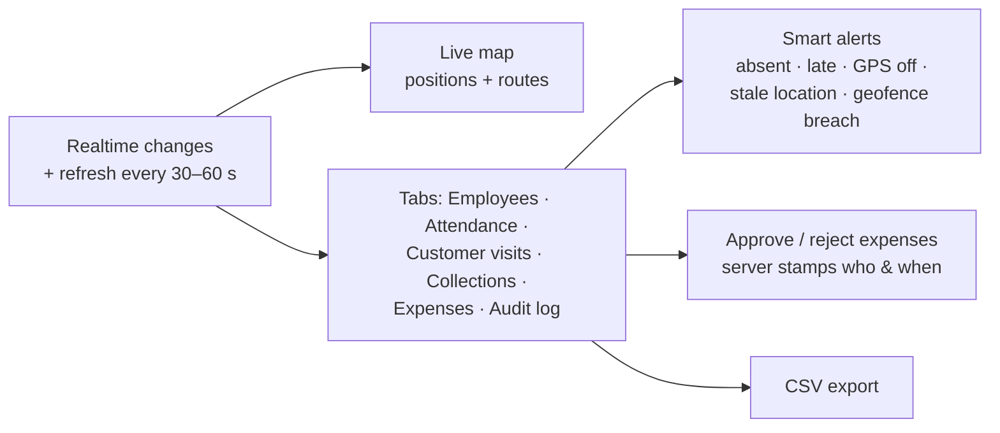
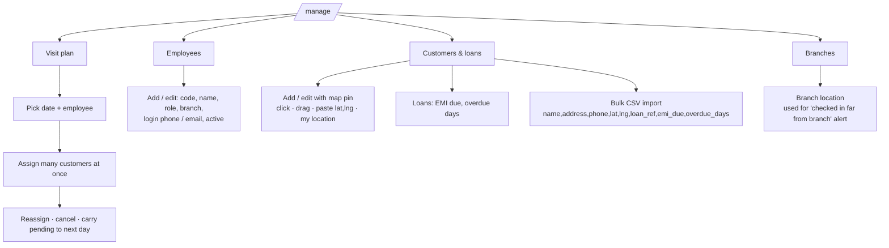
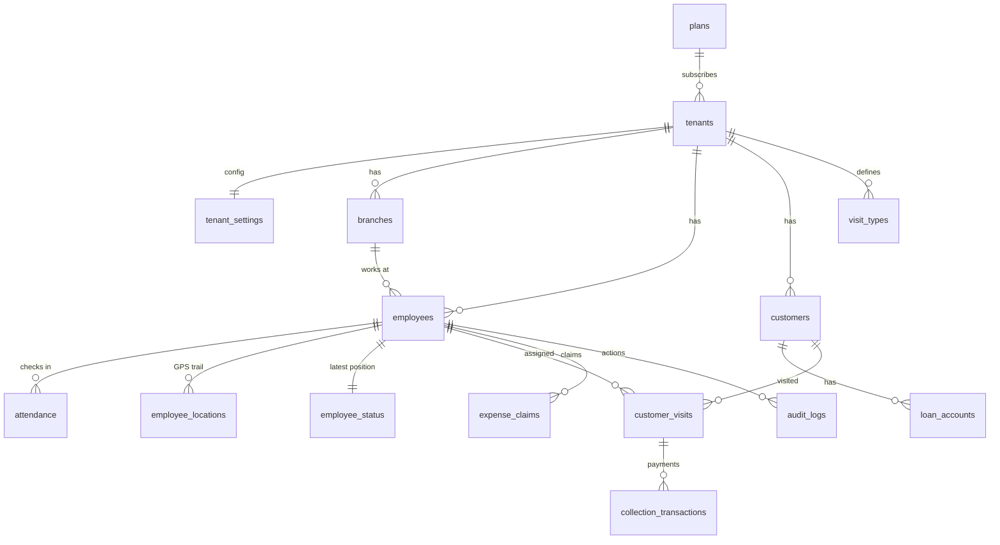

# FieldForce 360

FieldForce 360 is a configurable field-workforce tracking SaaS for banks, NBFCs and MFIs.

- **Field staff** use an Android app (or the web app). They check in with GPS and a selfie, visit assigned customers inside a geofence, collect EMIs, and claim expenses.
- **The MD and managers** use a web dashboard. They see everyone live on a map and plan the day's work. Every action is recorded in a traceable audit trail.

| | Link |
|---|---|
| Live demo (sample data, no login) | https://fieldforce360-demo.netlify.app · https://fieldforce360.pages.dev |
| Manager dashboard (real data) | `/admin` |
| Manage data: staff, customers, visit plan | `/manage` |
| Admin console: company settings, plans | `/settings` |
| Field staff web app | `/app` |
| Pricing page | `/pricing` |

---

## 1. Architecture



- **Front end:** plain HTML/JS (no build step), Leaflet + OpenStreetMap for maps.
- **Two modes:**
  - **Demo mode** keeps data in the browser (`localStorage`). It's used by the public demo and by any page opened with `?demo=1`.
  - **Cloud mode** uses Supabase. It's switched on when `www/js/backend-config.js` has a project URL and publishable key.
- **Sync layer** (`www/js/cloud.js`):
  - Pulls the tenant's data from the database into the same in-memory shape the demo uses, so screens work identically in both modes.
  - Pushes only the changes back.
  - Retries every 15 s when offline, and caches the last state per user.
- **Security lives in the database, not the screens.** Row Level Security limits every read and write by company (tenant) and role. The page only holds the public "publishable" key. The secret key is never used in the app.

---

## 2. Roles and what they can do

| Role | Field app | Dashboard | Manage page | Admin console |
|---|:-:|:-:|---|:-:|
| **Field** (field officer) | ✅ own day only | ❌ | ❌ | ❌ |
| **Manager** | ✅ | ✅ whole team | Plan visits (assign, reassign, cancel, carry forward) | ❌ |
| **Admin** | ✅ | ✅ | Everything: employees, customers & loans, branches, visits | ✅ |
| **Owner** (MD) | ✅ | ✅ | Everything | ✅ |

The database enforces these rules: a manager can't promote themselves, a field officer can't see colleagues' data, and nobody can edit GPS history.

---

## 3. Key flows

### 3.1 Sign-in (one-time code)

A person can sign in only if an admin has first added them on the **Manage → Employees** page with that phone number or email. A phone number or email can belong to only one employee per company.

### 3.2 A field officer's day

- GPS is accepted **only while on duty**. The database rejects location points from anyone who isn't checked in.
- Location history and collection records are **append-only**. They can't be edited or deleted, even by the app.

### 3.3 Manager / MD: watch the team live


### 3.4 Planning work (Manage page)


### 3.5 Configuring the product per company (Admin console)
Company name, logo and brand colour, plan and seats, on/off modules, tracking rules (interval, geofence radius, branch radius, working hours, late-after time), terminology ("Field Officer", "Customer", "Visit"), visit types with their outcomes and custom form fields, payment modes, receipt prefix, per-km rate and expense limits.

In cloud mode these settings are saved to `tenant_settings.app_config`, and every user's app picks them up the next time it loads.

---

## 4. Database (Supabase / Postgres)

The full definition is in [`db/schema.sql`](db/schema.sql), and setup steps are in [`SUPABASE_SETUP.md`](SUPABASE_SETUP.md).



| Group | Tables |
|---|---|
| SaaS & pricing | `plans`, `pricing_settings`, `tenants`, `tenant_settings` |
| Organisation | `branches`, `employees` (role: owner / admin / manager / field; login phone / email) |
| Customers | `customers`, `loan_accounts`, `visit_types` |
| Daily work | `attendance`, `employee_locations`, `employee_status`, `customer_visits`, `collection_transactions`, `expense_claims` |
| Traceability | `audit_logs`, `change_log` |

**Traceability built in:**
- `change_log`: a trigger records **every insert, update and delete** on business tables: old values, new values, who did it, and when.
- `employee_locations` and `collection_transactions` are **append-only**. Edits and deletes are blocked by a trigger.
- Each GPS point keeps both the phone's time (`recorded_at`) and the server's time (`received_at`), plus device info, so faked or back-dated points can be spotted.
- Expense approvals are stamped by the server (`decided_by`, `decided_at`), not by the browser.
- Selfies are stored in a **private** Storage bucket, and each company can access only its own folder.
- Old GPS points can be purged with `purge_old_locations()`, to keep data no longer than the retention policy allows.

---

## 5. Repository layout

| Path | What it is |
|---|---|
| `www/index.html`, `js/app.js` | Field staff app (also packaged into the APK) |
| `www/admin.html`, `js/admin.js` | Manager / MD live dashboard |
| `www/manage.html`, `js/manage.js` | Manage data: visit plan, employees, customers & loans, branches |
| `www/settings.html`, `js/settings.js` | Admin console: company, modules, rules, pricing plans |
| `www/pricing.html` | Public pricing page |
| `www/demo.html` | Side-by-side demo (phone + dashboard, sample data) |
| `www/js/config.js` | Module catalogue, plans, default company configuration |
| `www/js/seed.js`, `js/store.js` | Demo data and the in-browser data store |
| `www/js/cloud.js` | Supabase sync layer (login, pull/push, realtime, offline retry) |
| `www/js/backend-config.js` | Supabase project URL + publishable key (empty = demo mode) |
| `db/schema.sql` | Complete database: tables, security rules, triggers, storage, grants |
| `db/seed_demo.sql` | Re-runnable demo data for a new project |
| `android/`, `capacitor.config.json`, `build-apk.ps1` | Android APK build |
| `deploy-web.ps1` | Builds `site/` and deploys to Cloudflare Pages and Netlify |
| `PRODUCT_PLAN.md` | Feature catalogue, plans and pricing |
| `SUPABASE_SETUP.md` | Connecting the cloud database |
| `IT_INSTALL_REQUIREMENTS.md` | Developer PC software list for IT |

---

## 6. Run, build and deploy

Open `start-demo.bat` to run locally, or serve `www/` with any static web server.

Deploy the web pages to Cloudflare Pages and Netlify:
```powershell
npm run deploy
```

Build the Android APK. The output is `dist/FieldForce360-debug.apk`:
```powershell
powershell -ExecutionPolicy Bypass -File build-apk.ps1
```

---

## 7. Status and roadmap

**Done**
- Demo app, dashboard, admin console, pricing and plans.
- APK build.
- Hosting on Cloudflare Pages and Netlify.
- **Phase 1:** Supabase backend with OTP login, live sync, realtime dashboard, full audit trail, and the Manage data page.

**Next**
| Phase | Scope |
|---|---|
| 2: Live trial | Email codes in the sign-in templates. SMS provider for phone sign-in (needs DLT registration in India). Rebuild the APK on the live database. **Background GPS** (keeps tracking with the screen off). Trial with 3–5 real staff. |
| 3: Field features | Receipts to customers by SMS / WhatsApp, visit and bill photos, stronger offline mode, push notifications |
| 4: MD insights | Daily and monthly Excel / PDF reports, route playback, idle and off-route alerts, branch scorecards |
| 5: SaaS launch | Company self sign-up, Razorpay billing with seat limits, Mumbai-region database, DPDP Act consent and retention, Play Store release (API 36, background-location review) |
